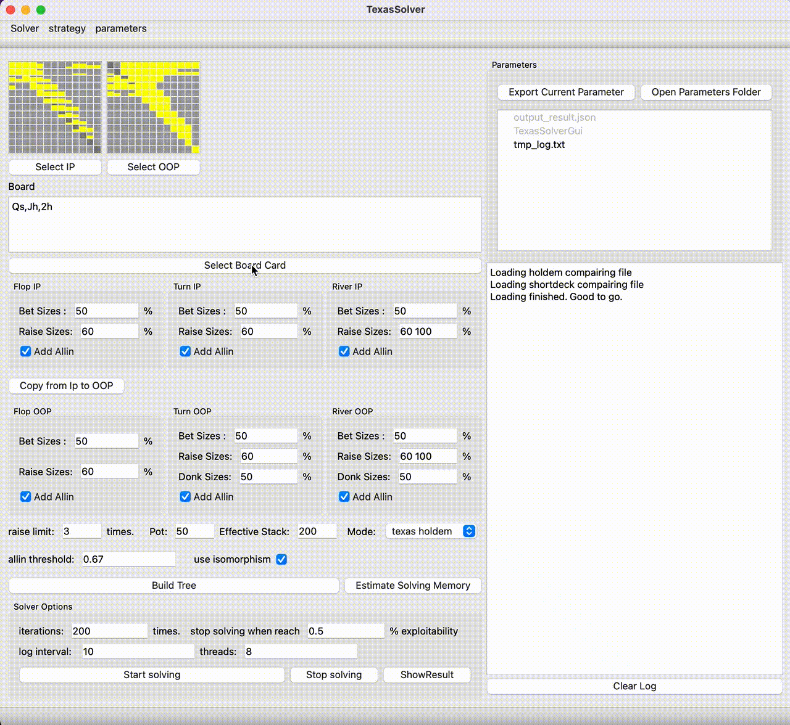

# :rotating_light: This project still works but a much much faster new GPU version is available here: [TexasSolverGPU](https://bupticybee.github.io/texassolver_gpu_page)

# CPP Texas Solver

[](https://github.com/bupticybee/TexasSolver/releases)
[](https://github.com/bupticybee/TexasSolver/blob/master/LICENSE)
[](https://colab.research.google.com/github/bupticybee/TexasSolver/blob/console/TexasSolverTechDemo.ipynb)
[](https://gitter.im/TexasSolver/TexasSolver)

README [English](README.md) | [中文](README.zh-CN.md)

## Introduction 
A open sourced, extremely efficient Texas Hold'em solver. See this [Introduction video](https://youtu.be/IsSJNz7sRmQ) for more. Supports Windows,MacOs and Linux.



Features:

- In a tree with 1~2bets + allin, it's speed exceeds piosolver on flop
- Support Mac, Linux and Windows
- Support cross language calls
- Result aliged with piosolver
- Support dump strategy to json file
- It's the c++ version of [TexasHoldemSolverJava](https://github.com/bupticybee/TexasHoldemSolverJava) with a ton of optimization, it's 5x faster than the java version and takes less than 1/3 memory.

Feel free to mess with a toy solver [in google colab](https://colab.research.google.com/github/bupticybee/TexasSolver/blob/console/TexasSolverTechDemo.ipynb)


## Install

Download package according to your OS in [release package](https://github.com/bupticybee/TexasSolver/releases), unzip it, and install is done. It's that simple.

## GUI version Usage

After install the solver, double click the application binary (TexasSolverGui.exe in windows or TexasSolverGui.app in MacOS) to run TexasSolver.

## GPU solving (OpenCL)

The solver runs on the GPU through OpenCL, so any GPU with an OpenCL driver works (NVIDIA, AMD, Intel). It picks the best available device automatically, preferring a discrete GPU, and logs which one it uses when a solve starts. The whole tree is kept in GPU memory; enabling "use half floats" stores the average strategy and evs as fp16 to fit larger trees.

If no OpenCL device is available, the tree does not fit in GPU memory, or a warmup is requested, the solver falls back to a single-threaded CPU solver. Set the environment variable `TEXASSOLVER_DISABLE_OPENCL=1` to force the CPU solver. The "threads" setting is no longer used.

Building needs the OpenCL headers and loader. CMake uses the system OpenCL SDK when it finds one, and otherwise downloads the Khronos headers and ICD loader. Configure with `-DTEXASSOLVER_BUILD_BENCH=ON` to also build `TexasSolverBench`, which solves a spot on the GPU and on the CPU and compares the strategies:

```
TexasSolverBench <resource_dir> <board> <iterations> [gpu|cpu|both] [half_floats]
```

## Console version Usage

Please check [console version document](https://github.com/bupticybee/TexasSolver/tree/console#usage) for more.

## Speed benchmark with piosolver

Piosolver and my TexasSolver(console version) run use the same settings (spr=10,flop game) and their result are aligned.

|                                | Input config                                              | log                                                          | thread number | memory usage | accuracy | converge time |
| ------------------------------ | --------------------------------------------------------- | ------------------------------------------------------------ | ------------- | ------------ | -------- | ------------- |
| piosolver 1.0                  | [config_piosolver](benchmark/benchmark_piosolver.txt)     | [log_piosolver](benchmark/benchmark_outputs/piosolver_log.txt) | 6             | 492Mb        | 0.29%    | 242s          |
| TexasSolver 0.1.0 (Our solver) | [config_texassolver](benchmark/benchmark_texassolver.txt) | [log_texassolver](benchmark/benchmark_outputs/texassolver_log.txt) | 6             | 1600Mb       | 0.275%   | 172s          |

The compare image of their results is  [here](benchmark/benchmark_outputs/result_compair.png). As you can see their result are very close.

# License

[GNU AGPL v3](https://www.gnu.org/licenses/agpl-3.0.en.html)

This software is licensed to person/business here: 
 [licensed_list](licensed_list.txt)

# Email

icybee@yeah.net

# Q & As

1. Q: Is the solver really free?
   - A: Yes, for personal users, the solver is completely opensourced and free.

2. Q: Can I upload it to other websites or forums? Can I share it with my friend?
   - A: No, you can only put the link of this project to other website, not the binary, this project is under AGPL-V3 license, and these kind of actions violates this license.

3. Q: Can I integrate it to my software?
   - A: If you integrate the release package (binary) into your software, Yes, you can do that. If you want to integrate the code of the solver into your software or provide service through internet, then you need to contact me for a commercial license, which is also the main profit-making method of this project.

4. Q: What framework do you use to write the ui?
   - A: I use QT 5.1.0 (opensourced edition) to build the GUI version. For the console version, I use Mingw + CMake.

